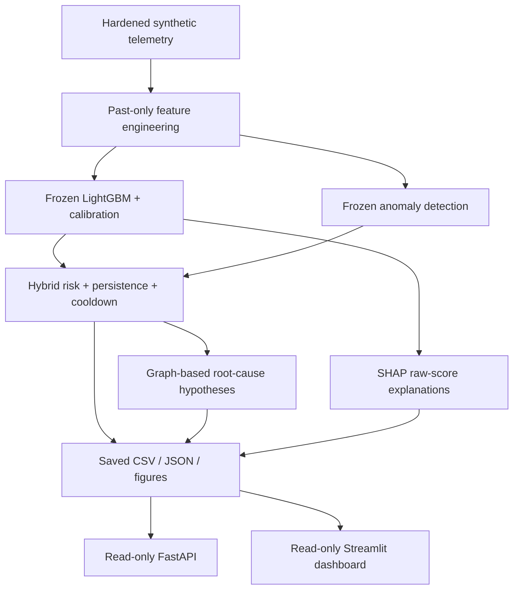

# SentinelDC

**Failure intelligence for simulated data-center infrastructure.** SentinelDC combines calibrated failure prediction, anomaly detection, operational alert policies, infrastructure hypotheses, and SHAP explanations in a read-only FastAPI and Streamlit demo.

> SentinelDC is a portfolio research prototype evaluated on hardened synthetic data-center telemetry. It is not a production monitoring system.

## Problem

Hardware failure signals are rare, noisy, and spread across many telemetry channels. A high-recall classifier can still overwhelm operators with false positives. Operators need event-level warnings, manageable alert policies, and evidence explaining what triggered a score.

## Why This Matters

This project treats detection, alert burden, and interpretability as separate engineering problems. It preserves weak results rather than improving them through test-set tuning. The goal is a credible, reproducible research workflow and a clear operational demo—not a claim of production readiness.

## System Architecture



SHAP explains the supervised estimator directly. It does not validate root-cause hypotheses. The dashboard and API share artifact loaders and do not depend on each other. Neither serves new predictions or runs a training pipeline. See [architecture](docs/ARCHITECTURE.md) and the preserved [scientific methods](docs/SCIENTIFIC_METHODS.md).

## Key Features

- Calibrated LightGBM failure probabilities with validation-only selection and thresholds.
- Independent robust-statistical anomaly signals and complementary hybrid detection.
- Chronological alert persistence, emergency conditions and cooldown.
- Typed datacenter → rack → switch → server dependency graph.
- Deterministic root-cause hypotheses with explicit UNKNOWN outcomes.
- Global, local, event-level and latest-snapshot SHAP explanations.
- Seven dashboard pages, a read-only API with OpenAPI docs, and two-service Docker support.
- Protected artifact manifests and regression tests; no training at serving startup.

## Dataset

The benchmark contains **360,000 hourly telemetry observations from 500 simulated servers**, arranged in 5 datacenters, 25 racks and 25 switches. There are 300 actual simulated failure events overall. Failure-positive telemetry is rare. The generator includes varied workload behavior and ambiguous precursors; it is not real company telemetry.

The saved TEST event population contains 43 failures represented in warning windows, including events whose actual failure timestamps fall after the final TEST observation. Partial warning windows are identified in event reports. Each rack has one switch with identical server membership, limiting causal attribution.

## ML Methodology

Chronological TRAIN/VALIDATION/TEST splits include 24-hour purges to prevent outcome-window overlap. Training fits preprocessing, class weighting and estimators. Validation selects models by PR-AUC, fits calibration on an early validation window, and selects thresholds on a later purged policy window. TEST is reserved for final evaluation; later SHAP and diagnostic analyses are post-hoc and never tune behavior.

Rare-event evaluation uses PR-AUC, ROC-AUC, raw row precision/recall, and event-level operational metrics. The supervised alert policy requires two consecutive hourly threshold exceedances or an emergency exceedance, with a six-hour cooldown. Its frozen threshold is 0.037; emergency threshold is 0.5. Anomaly and hybrid policies are independently frozen. Raw positive rows are not independent operational incidents.

## Detection Systems

**Supervised:** frozen LightGBM with TRAIN-only class weights and saved median imputation, followed by validation-fitted Platt calibration.

**Anomaly:** robust-statistical normal-behavior detector fitted on healthy TRAIN rows, compared with Isolation Forest using validation only. Anomaly scores and percentiles are not failure probabilities.

**Hybrid:** validation-selected combination of supervised and anomaly evidence with saved risk levels and operational policies. It increases event coverage while retaining substantial false-alert burden.

## Root-Cause Intelligence

A 555-node, 550-edge graph supports bounded three-hour incident grouping and deterministic infrastructure hypothesis ranking. Forty-eight-hour historical baselines exclude the current and future rows. Failure types and timestamps are loaded only after inference for evaluation.

These are **hypotheses, not confirmed causal diagnoses**. Exact rack/switch component failures are not labeled. The frozen evaluation has 0/41 correct signature classifications, 36 UNKNOWN and five incorrect non-UNKNOWN classifications; 158 of 180 incidents are UNKNOWN/low-evidence. This experimental subsystem was not tuned to improve TEST results.

## Explainability

SHAP explains the underlying frozen LightGBM raw log-odds after saved preprocessing, not the calibration layer. Displayed probabilities use the calibration wrapper separately. The global sample contains 2,000 TEST observations; saved reports include 200 local explanations, 41 detected-event explanations and a 500-server snapshot. Uptime is the strongest mean-absolute SHAP feature.

**SHAP shows which features influenced the model prediction; it does not prove that they caused a failure.** Correlations, workload patterns and synthetic artifacts can influence attributions. Root-cause intelligence proposes infrastructure hypotheses; neither method alone establishes causation.

## Dashboard

Seven read-only pages: Executive Overview, Live Server Monitor, Failure Intelligence, Incident / Root-Cause Explorer, Model Explainability, Model Performance, and Architecture & Limitations. Search/filter servers; inspect saved probabilities, reason codes and SHAP drivers; view historical telemetry with saved alert overlays. The combined intelligence panel keeps supervised, anomaly, hybrid and root-cause evidence separate.

“Live” means the **latest saved historical snapshot**, not live streaming or real-time monitoring. Its timestamp is displayed prominently. Static example figures are labeled with their fixed example IDs and do not change when another incident is selected.

## API

| Method | Route | Purpose |
|---|---|---|
| GET | `/health` | Process health, project, version |
| GET | `/summary` | Snapshot and event metrics |
| GET | `/servers` | Saved snapshot; optional `risk_level`, `rack_id`, `switch_id` filters |
| GET | `/servers/{server_id}` | Server scores and saved top SHAP drivers |
| GET | `/incidents` | Incident summaries |
| GET | `/incidents/{incident_id}` | Full saved evidence and candidates |
| GET | `/model-performance` | Frozen detector metrics and limitations |

Interactive docs: `http://localhost:8000/docs`; schema: `/openapi.json`. Invalid risk levels return 400, missing IDs return 404, artifact load/validation failures return 500. Framework type-validation errors may return 422. `/health` checks process liveness; `/summary` also exercises artifact reads. No write or prediction endpoints exist. No authentication is implemented; local demo ports bind to loopback. Do not expose publicly without deployment hardening.

## Docker

The Python 3.11 image installs only serving dependencies, not the ML training stack. API and dashboard run as a non-root user with read-only mounts of local `reports/`, `models/` and `data/`. Artifacts are not baked into the image or changed at startup. Docker build/startup never trains models. Docker Desktop or another Docker engine with Compose is required; see local verification status in `reports/final_project_integrity.json`.

## Results

Frozen TEST results from the current saved report files:

| System | Row PR-AUC | Detected events | Event detection | Operational precision | False operational alerts | Median warning |
|---|---:|---:|---:|---:|---:|---:|
| Supervised | 0.1046 | 36/43 | 83.72% | 3.26% | 2,580 | 20 h |
| Anomaly | 0.0242 | 39/43 | 90.70% | 1.93% | 5,336 | 21 h |
| Hybrid | 0.0553 | 41/43 | 95.35% | 2.83% | 3,780 | 21 h |

Sources: `reports/final_test_metrics.csv`, `anomaly_test_metrics.csv`, `operational_alert_metrics.csv`, `anomaly_operational_metrics.csv`, and `hybrid_test_metrics.csv`. Dashboard/API read these dynamically. Operational precision counts true warning alerts; event detection counts each failure once. Median lead time is conditional on detected events. The hybrid produces 3,890 total operational alerts; its false-alert rate is 1.68 per observed server-day. These are not production service-level claims.

## Known Limitations

- Synthetic telemetry cannot establish real-world generalization.
- Operational precision is low and false-alert burden is substantial.
- Root-cause signatures performed poorly; exact shared-component causal truth is unavailable.
- Rack-versus-switch attribution is structurally ambiguous.
- SHAP explains learned associations, not causation.
- Saved TEST reports are historical; no live ingestion, online inference, authentication or production alert delivery is implemented.
- Large source datasets remain external read-only mounts for the Docker demo.

## Project Structure

```text
api/                         FastAPI routes, schemas and services
dashboard/                   Streamlit pages, components, artifact loaders
src/                         Frozen scientific pipeline + explainability
data/                        Hardened synthetic raw/processed telemetry
models/                      Frozen models, policies and infrastructure graph
reports/                     Frozen metrics, events, explanations and figures
docs/                        Architecture, scientific methods, demo, interview, resume
scripts/                     Local startup helpers
tests/                       Scientific and read-only serving regression tests
Dockerfile                   Lightweight serving image
docker-compose.yml           API + dashboard with read-only artifact mounts
requirements-app.txt         Serving-only dependencies
requirements.txt             Full research and serving dependencies
```

## Installation

Run commands from the project directory containing this README. Python 3.11 is recommended, including native arm64 Python on Apple Silicon. Existing model files are trusted local artifacts; serving does not deserialize them.

```bash
python3.11 -m venv .venv
source .venv/bin/activate
python -m pip install -r requirements-app.txt
```

Serving needs existing `reports/`, `models/infrastructure_graph.graphml`, `models/decision_threshold.json` and processed telemetry. Keep the full supplied artifact directories for the demo. For the complete test suite/scientific environment, install the full dependencies:

```bash
# macOS/Apple Silicon: needed for existing LightGBM/XGBoost, not serving itself
brew install libomp
python -m pip install -r requirements-root-cause.txt
```

Do not run training pipelines to start the application. New UI dependencies and documentation are authorized changes; previous hash manifests are retained as historical records. Their old requirements.txt fingerprints predate dependency additions. `final_project_protected_artifacts.json` separately protects all frozen science/data/SHAP files.

## Running Dashboard

```bash
source .venv/bin/activate
streamlit run dashboard/app.py
```

Open `http://localhost:8501`. Alternatively run `./scripts/run_dashboard.sh`. Data is cached in memory; restart the service after deliberately replacing a frozen artifact bundle.

## Running API

```bash
source .venv/bin/activate
uvicorn api.main:app --reload
```

Open `http://localhost:8000/docs`. `./scripts/run_all.sh` runs both local services and stops the API on exit. Each can also be started independently.

## Running Docker

```bash
docker compose up --build
```

Dashboard: `http://localhost:8501` · API: `http://localhost:8000` · API docs: `http://localhost:8000/docs`.

Stop with Ctrl-C, then `docker compose down`. Neither command modifies the frozen artifacts. `docker compose config` validates the configuration when Docker is installed.

## Running Tests

```bash
source .venv/bin/activate
pytest -q
python -c "import dashboard.app"
python -c "import api.main"
```

Tests include FastAPI TestClient, loader validation, artifact hashes and simulated Streamlit page rendering; no Streamlit server is launched by pytest. The production artifact set is never retrained by tests. See `reports/final_project_integrity.json` for the final test count and smoke-test status.

## Screenshots

Capture real running pages; do not substitute fabricated screenshots. Expected files (placeholders until captured):

- `docs/dashboard_overview.png` — Executive Overview
- `docs/server_detail.png` — selected server and telemetry
- `docs/root_cause_view.png` — incident hypothesis
- `docs/shap_view.png` — model explanation

## Future Work

Evaluate real telemetry and alert budgets before production use. Kafka/Spark ingestion, AWS deployment, Neo4j, GNNs and an LLM operations copilot are future work only. Other priorities include temporal drift monitoring, richer component-level ground truth, external validation, authentication and operational feedback.

Start with the [five-minute demo](docs/DEMO_GUIDE.md), [interview guide](docs/INTERVIEW_GUIDE.md) and [resume bullets](docs/RESUME_BULLETS.md).
