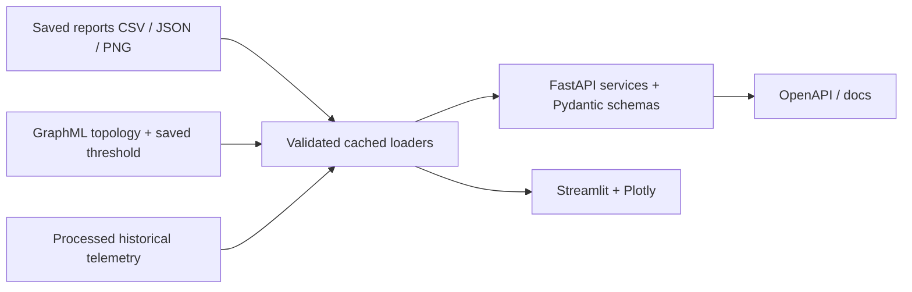

# SentinelDC Architecture

## Scientific pipeline (offline and frozen)

The generator creates hourly synthetic telemetry and outcome catalogs. Past-only feature engineering produces 32 model features; identifiers and future outcome metadata are excluded from estimator inputs. TRAIN fits preprocessing, class weights and candidate models. Chronologically separated validation windows select/calibrate models and alert policies. Twenty-four-hour purges protect failure-window boundaries. TEST evaluates the frozen choices. Detailed historical design is preserved in [SCIENTIFIC_METHODS.md](SCIENTIFIC_METHODS.md).

LightGBM predicts failure-window risk, with Platt calibration providing displayed probabilities. The robust anomaly detector learns healthy TRAIN behavior and reports unusualness, not failure probability. A validation-selected hybrid combines those signals. Stateful, chronological persistence and cooldown convert row scores to operational warning incidents. Evaluation matches each failure to its first eligible warning, separating alert precision from unique event coverage.

The infrastructure graph represents datacenters, racks, switches and servers. Root-cause inference groups saved alerts in fixed three-hour datacenter windows, compares telemetry to strictly past 48-hour baselines, and ranks heuristic signatures and component hypotheses. UNKNOWN is retained when evidence is insufficient. Outcome metadata is introduced only for subsequent signature evaluation. Identical rack/switch membership and absent component ground truth prohibit exact component-causality claims.

SHAP explains the underlying frozen LightGBM raw margin after its saved imputer, separately from calibration. A 2,000-observation global sample and deduplicated local/event/snapshot rows are explained without fitting. The cache is written before event metadata joins. Explanations describe model associations, not physical causality.

## Serving architecture (read-only)

`dashboard/data_loader.py` is the shared artifact access layer. It uses bounded in-memory caches keyed by file modification time for CSV/JSON; static graph and telemetry caches last for the process lifetime. Caller-facing CSV/JSON reads return copies. Snapshot joining requires unique server/timestamp keys, identical key sets and matching scores/risk labels. Datacenter membership comes from saved GraphML. No ML package is imported by serving modules, and models are not deserialized.

Telemetry charts read existing columns and overlay saved hybrid operational alerts. Missing overlays outside TEST do not imply no historical risk. Static graph/waterfall examples are clearly labeled; selected incidents do not silently reuse them as their own evidence. Latest “live” views are historical snapshots, not streaming updates.

The API offers GET-only routes, Pydantic response validation, 400 for invalid risk filters, 404 for unknown IDs and sanitized 500 responses for artifact failures. `/health` checks liveness; `/summary` exercises artifact availability. FastAPI validation can also return 422. No authentication or public-service guarantees are present.

## Packaging and verification

A lightweight Python 3.11 Docker image installs only `requirements-app.txt`. Two Compose services mount artifacts read-only; ports bind to localhost; processes run as a non-root user with a read-only root filesystem and temporary `/tmp`. Build/startup cannot run scientific pipelines because no training code is included in the image. Models and datasets are not copied into the build context.

Existing science, reports, models, tests and dataset files are fingerprinted in `reports/final_project_protected_artifacts.json`. Final verification compares them without updating old scientific manifests or metrics. UI/documentation/dependency additions are outside the frozen science scope. Tests exercise artifact schemas, APIs, error paths, simulated dashboard rendering and hash preservation. Docker runtime validation depends on an available engine and is reported separately.

## Limits and next steps

Frozen hybrid coverage is 41/43 events, but alert precision is approximately 2.83%; false alerts are a central limitation, not a solved problem. Root-cause signature accuracy is 0/41 with 36 UNKNOWN; it is experimental. Real telemetry, drift evaluation, alert budgets, component ground truth, access control and deployment observability would be required for a production system. Kafka, Spark, cloud, graph databases, GNNs and LLM tools are not implemented.
